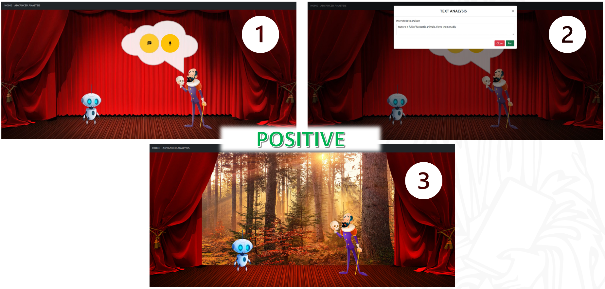
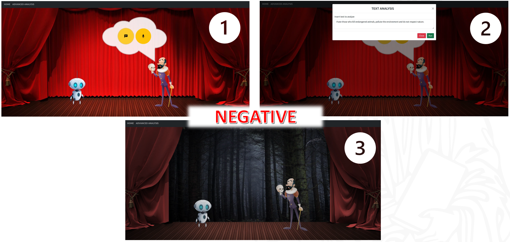

# Natural Language Processing for Sentiment and Topic Recognition

The goal of this project is to extract useful information such as sentiment and topic from individual sentences instead of entire documents. This is achieved without the need for pre-labeled data, leveraging unsupervised machine learning algorithms. The extracted data can be used to create adaptive settings with stage effects, sound effects, and graphics to enhance viewer experiences in stage and theater settings. This software also provides a web interface that simulates these effects.

## Features

- **Sentiment Analysis**: Detects the sentiment (positive, neutral or negative) of sentences.
- **Topic Recognition**: Identifies the main topic of sentences.
- **Unsupervised Learning**: Operates without the need for labeled training data.
- **Adaptive Settings**: Utilizes sentiment and topic data to influence stage and theater settings.
- **Speech Input**: Sentences can also be spoken and recorded directly from the browser.
- **Web Interface**: A user-friendly web interface to demonstrate the capabilities of the software.

## Requirements

The project runs on Python 3.12 and uses the following main dependencies (see `requirements.txt`):

- `django`
- `django rest framework`
- `nltk`
- `gensim`
- `pandas`
- `numpy`
- `langdetect`
- `SpeechRecognition`

## Getting Started

Follow these instructions to get a copy of the project up and running on your local machine.

### Prerequisites

Ensure you have [Docker](https://www.docker.com/get-started) installed on your system.

### Installation

1. Clone the repository:
    ```sh
    git clone https://github.com/sbaglieri13/TextAnalysis.git
    cd TextAnalysis
    ```

2. Build the Docker image:
    ```sh
    docker build -t textanalysis .
    ```

3. Run the Docker container:
    ```sh
    docker run -d -p 8000:8000 -e DJANGO_SECRET_KEY=change-me textanalysis
    ```

## Usage

Once the Docker container is running, open http://localhost:8000 to start analyzing text for sentiment and topics.

### Web Interface

The web interface provides visual feedback based on the analyzed sentiment and topic of the input text.

#### Output with Topic: Nature and Sentiment: Positive
<p align='center'>

</p>

#### Output with Topic: Nature and Sentiment: Negative
<p align='center'>

</p>