# Natural Language Processing for Sentiment and Topic Recognition

The goal of this project is to extract useful information such as sentiment and topic from individual sentences instead of entire documents. This is achieved without the need for pre-labeled data, leveraging unsupervised machine learning algorithms. The extracted data can be used to create adaptive settings with stage effects, sound effects, and graphics to enhance viewer experiences in stage and theater settings. This software also provides a web interface that simulates these effects.

<p align="center">
  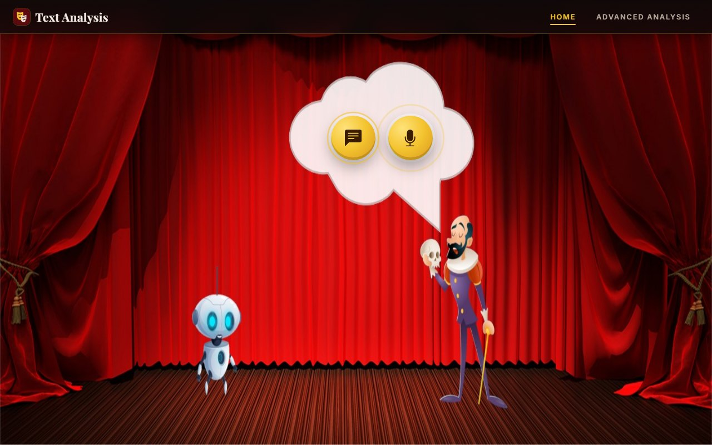
</p>

## Features

- **Sentiment Analysis**: Detects the sentiment (positive, neutral or negative) of every sentence and of the whole text.
- **Topic Recognition**: Identifies the main topic of sentences.
- **Unsupervised Learning**: Operates without the need for labeled training data.
- **Adaptive Settings**: Utilizes sentiment and topic data to change the stage scenery and background music.
- **Speech Input**: Sentences can also be spoken and recorded directly from the browser.
- **Custom Topic Models**: In the *Advanced Analysis* page a topic model is trained on any text file you upload.
- **Web Interface**: A user-friendly web interface to demonstrate the capabilities of the software, on desktop and mobile.

## How it works

| Step | Description |
|---|---|
| **Speech-to-text** | Audio recorded in the browser is transcribed with the Google Web Speech API. |
| **Preprocessing** | Tokenization, POS tagging, lemmatization and stop-word removal with NLTK. |
| **Sentiment** | [VADER](https://github.com/cjhutto/vaderSentiment) gives every sentence a *compound* score from -1 to 1: positive above 0.05, negative below -0.05, neutral in between. |
| **Topic (Home)** | An LDA model (gensim) trained on a corpus of BBC news articles. Each of its 10 topics is labelled automatically (e.g. *Nature - Environment*, *News & Politics*, *Business*) from its most probable words. |
| **Topic (Advanced Analysis)** | A new LDA model is trained on the text file you upload, and the topic of your sentence is described by its 10 most probable words. |

## Requirements

The project runs on Python 3.12 and uses the following main dependencies (see `requirements.txt`):

- `django`
- `django rest framework`
- `nltk`
- `gensim`
- `pandas`
- `numpy`
- `langdetect`
- `SpeechRecognition`

## Getting Started

Follow these instructions to get a copy of the project up and running on your local machine.

### Prerequisites

Ensure you have [Docker](https://www.docker.com/get-started) installed on your system.

### Installation

1. Clone the repository:
    ```sh
    git clone https://github.com/sbaglieri13/TextAnalysis.git
    cd TextAnalysis
    ```

2. Build the Docker image (the topic model is trained during the build):
    ```sh
    docker build -t textanalysis .
    ```

3. Run the Docker container:
    ```sh
    docker run -d -p 8000:8000 -e DJANGO_SECRET_KEY=change-me textanalysis
    ```

4. Open http://localhost:8000.

<details>
<summary>Run without Docker</summary>

```sh
python -m venv .venv
source .venv/bin/activate          # Windows: .venv\Scripts\activate
pip install -r requirements.txt
cp .env.example .env               # Windows: copy .env.example .env

python manage.py download_nltk_data
python manage.py train_topic_model
python manage.py migrate
python manage.py runserver
```
</details>

## Usage

The web interface has two pages: **Home** and **Advanced Analysis**.

### Home: the adaptive stage

1. Click the **text** button in the speech bubble, write a sentence in English and press **Run**,
   or click the **microphone** button, press **Record**, speak and press **Stop**.
2. The sentence is analyzed and the stage reacts: the scenery and the music change according to the
   detected **topic** (nature, news & politics, arts & culture) and **sentiment** (positive, neutral, negative).

<p align="center">
  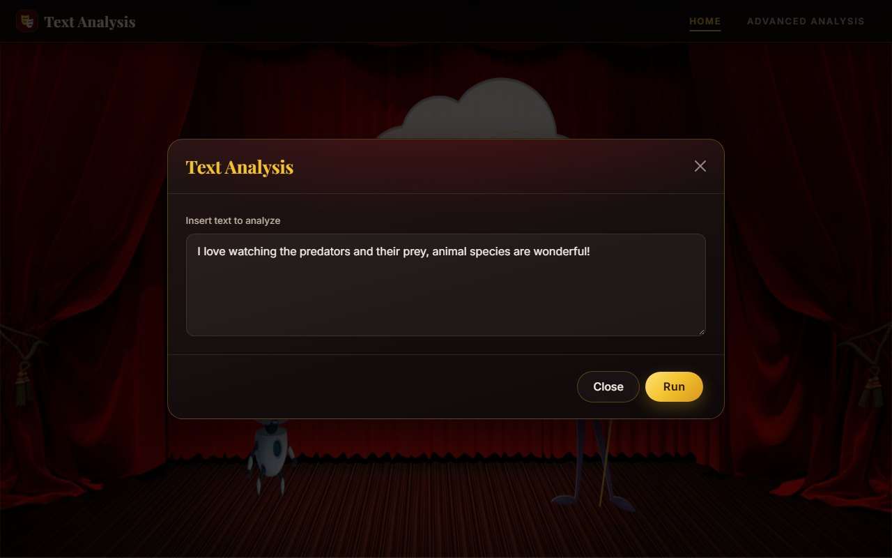
  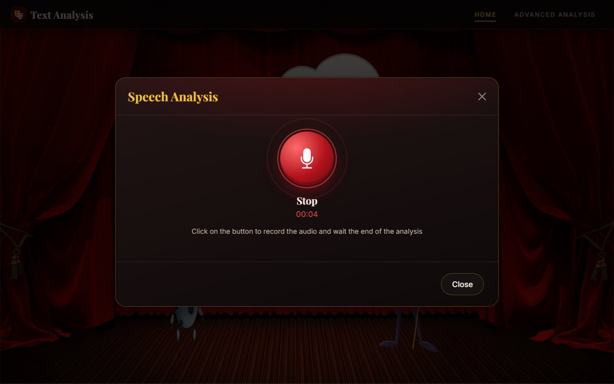
</p>

#### Topic: Nature, Sentiment: Positive
<p align="center">
  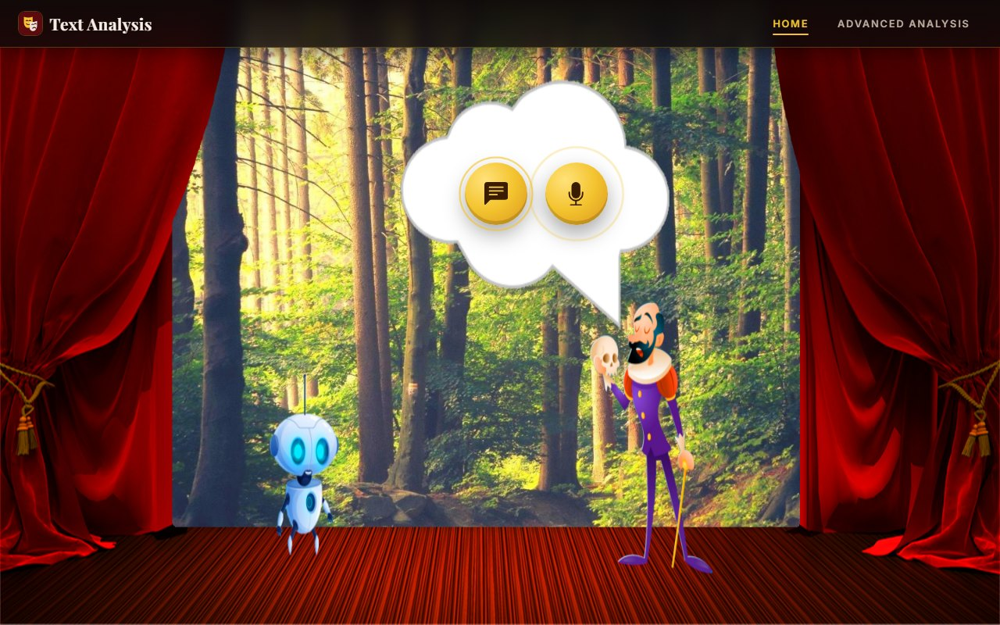
</p>

#### Topic: Nature, Sentiment: Negative
<p align="center">
  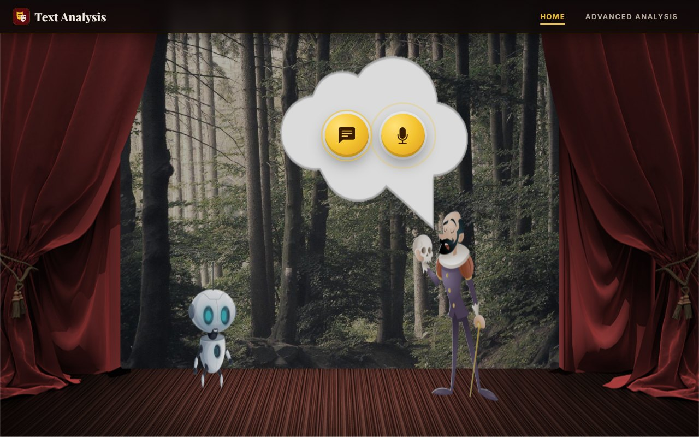
</p>

#### Topic: News & Politics, Sentiment: Negative
<p align="center">
  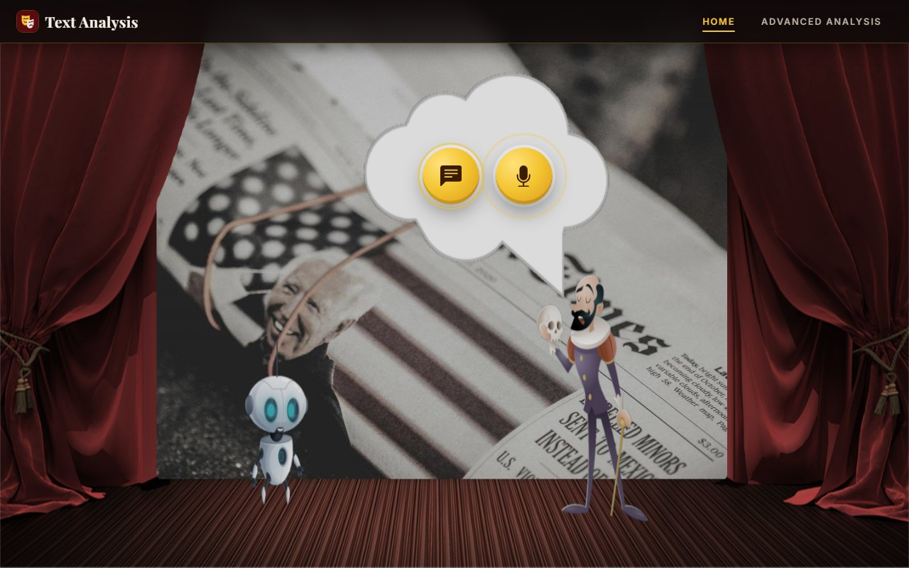
</p>

Some sentences to try:

| Sentence | Topic | Sentiment |
|---|---|---|
| *I love watching the predators and their prey, animal species are wonderful!* | Nature | Positive |
| *Predators hunt their prey and animal species adapt their body.* | Nature | Neutral |
| *Predators hunt their prey in the wild, and many animal species are at risk of extinction.* | Nature | Negative |
| *Trump and the party celebrated a great victory, the president thanked every voter.* | News & Politics | Positive |
| *The president will meet the government ministers of the country on Tuesday.* | News & Politics | Neutral |
| *The country closed its border and the president blamed Europe for the terrible crisis.* | News & Politics | Negative |

### Advanced Analysis: topic modelling on your own data

Here the topic model is not fixed: it is trained on a text file of your choice, so you can analyze
sentences from any domain.

1. Choose **Text** or **Speech**.
2. Upload a `.txt` file in English (two samples are included in [`data/samples`](data/samples): *Romeo and Juliet* and *Antony and Cleopatra*).
3. Write (or record) a sentence and press **Run**.

<p align="center">
  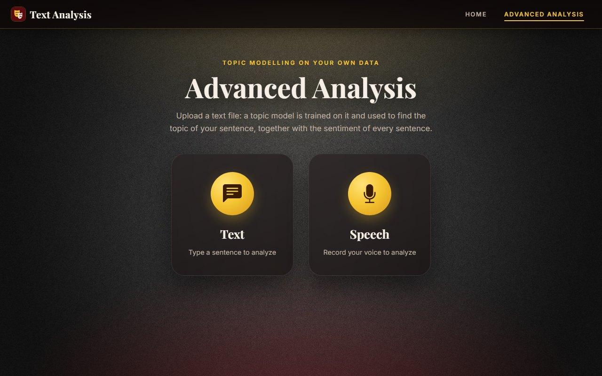
  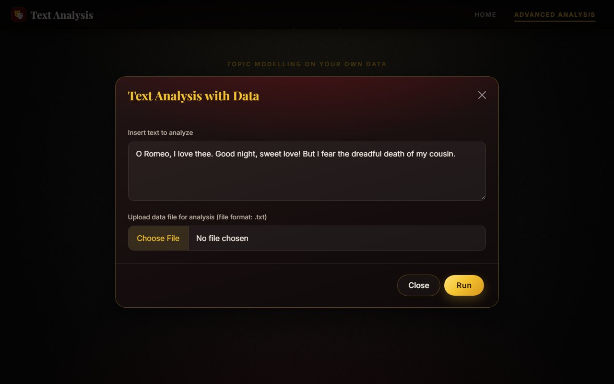
</p>

The result page shows:

- the **input text**;
- the **topic** of the sentence, described by its most probable words in the uploaded file, with its probability;
- the **sentiment** of the text: the share of positive, neutral and negative sentences;
- the **sentiment of every sentence**, with its compound score.

<p align="center">
  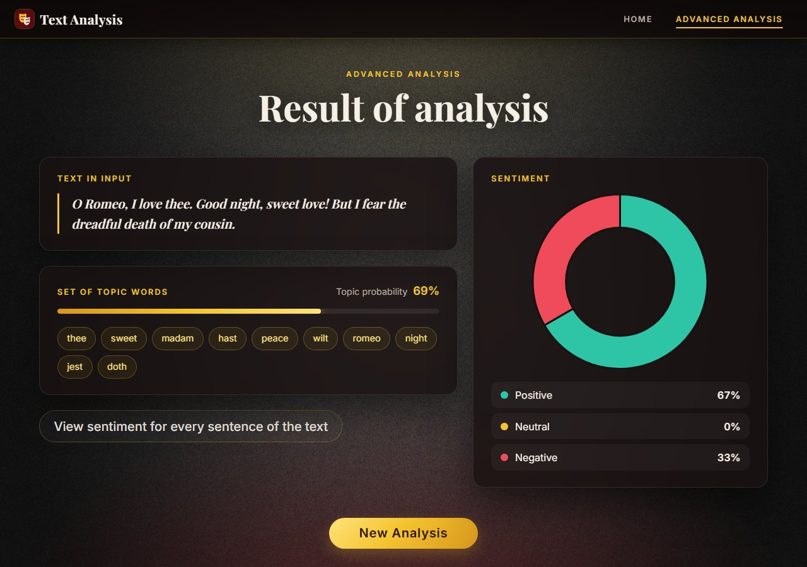
</p>

<p align="center">
  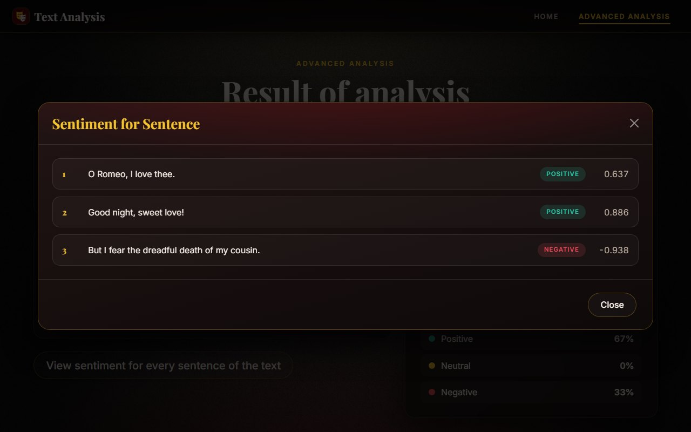
</p>

The example above uses `data/samples/romeo-and-juliet.txt` and the sentence
*"O Romeo, I love thee. Good night, sweet love! But I fear the dreadful death of my cousin."*

### Mobile

The interface also works on smartphones.

<p align="center">
  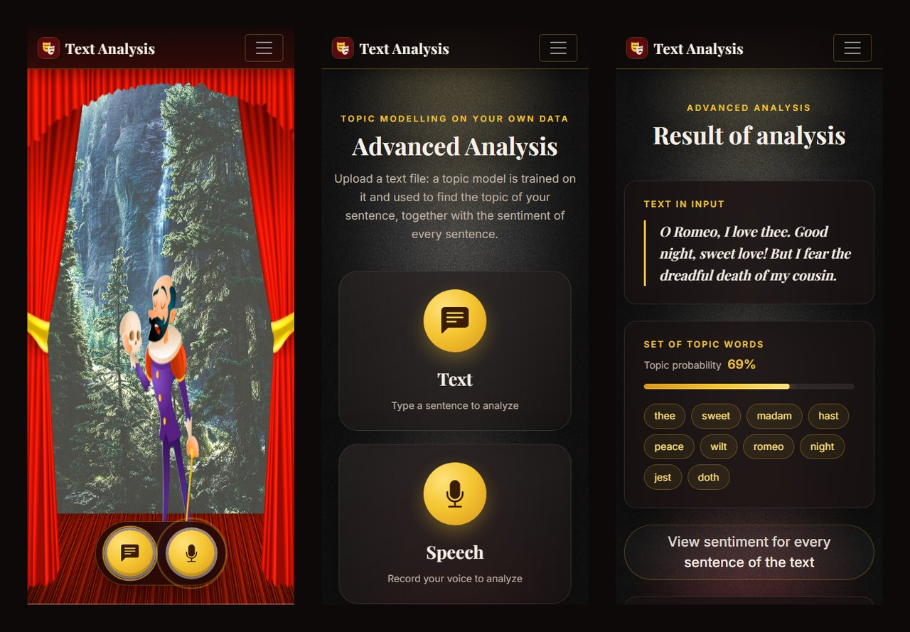
</p>

## Limitations

- English only.
- The topic model of the Home page is trained on a small corpus (about 250 BBC articles), so its topics are coarse: for example, no *Arts & Culture* topic emerges from it.
- VADER is designed for short, informal texts and handles sarcasm poorly.
- Speech-to-text needs an internet connection.
